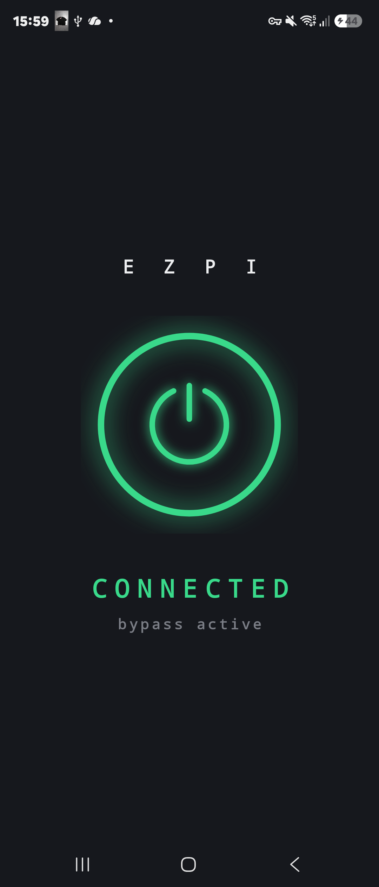
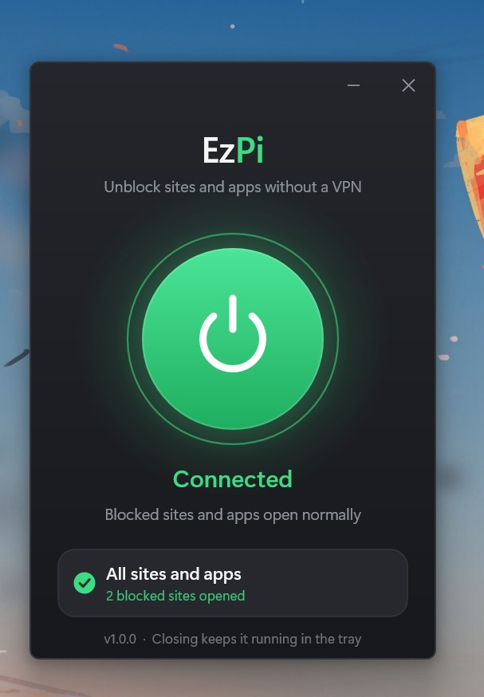

# EzPi

```
 _______   ________  ________  ___
|\  ___ \ |\_____  \|\   __  \|\  \
\ \   __/| \|___/  /\ \  \|\  \ \  \
 \ \  \_|/__   /  / /\ \   ____\ \  \
  \ \  \_|\ \ /  /_/__\ \  \___|\ \  \
   \ \_______\\________\ \__\    \ \__\
    \|_______|\|_______|\|__|     \|__|
```

EzPi unblocks websites and apps that your internet company blocks — **without a VPN**, without the speed and memory cost of one.

It runs on **Linux** (a tiny ~15 MB background service), **Android** (a one-tap, no-root app), and **Windows** (a tray app). Same bypass everywhere, on Wi-Fi and mobile data.

It never reads or touches your actual data. It just hides the one thing the block looks at: the site's name.

## 1. Install it (Linux)

Open a terminal in this folder and run:

```sh
sudo ./install.sh
```

That's it. It sets everything up for you.

## 2. Turn it on and off

Just type:

```sh
ezpi
```

- First time you type it → **it turns ON** → `EzPi started successfully.`
- Type `ezpi` again → **it turns OFF** → `EzPi stopped.`

One word. That's the whole thing.

## 3. Is it actually working?

```sh
ezpi --check
```

This tests it live and tells you yes or no.

Want to see the logo?

```sh
ezpi --wizard
```

## 📱 Android

A one-tap app that needs **no root**. It uses Android's own VPN button and runs the *exact same* split + DoH engine as the Linux version, so it beats the same blocks — proven on mobile data.



Install it, tap **Connect**, allow the VPN prompt once. Done.

Build it from the [`android/`](android/) folder — steps are in [android/README.md](android/README.md).

## 🪟 Windows

A native Windows build — separate implementation, same job.



Download it:

**[⬇ EzPi-windows-x64.exe](https://github.com/SunqdXX/ezpi/releases/latest/download/EzPi-windows-x64.exe)**

Run it once; it installs itself (one admin prompt), then runs quietly from the system tray. The Windows version is by **[@yasinlol](https://github.com/yasinlol)**.

## Remove it

```sh
sudo ./install.sh --uninstall
```

## What it does (simple version)

When you open a website, your internet company can see the site's **name** and block it. EzPi hides that name so the block can't catch it. Your sites open normally.

It never reads or touches your actual data. It just hides the name.

## Build it yourself (optional)

```sh
make build
make test
```

## License

MIT. Do whatever you want with it. See [LICENSE](LICENSE).

---

*#### Windows, and its users do NOT deserve My Projects.*
