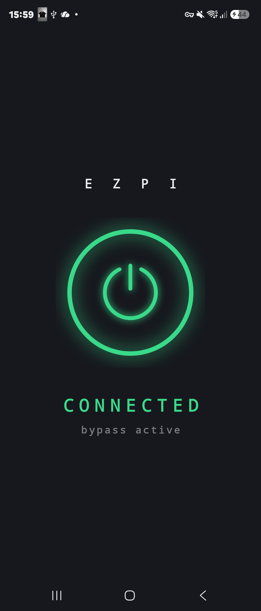
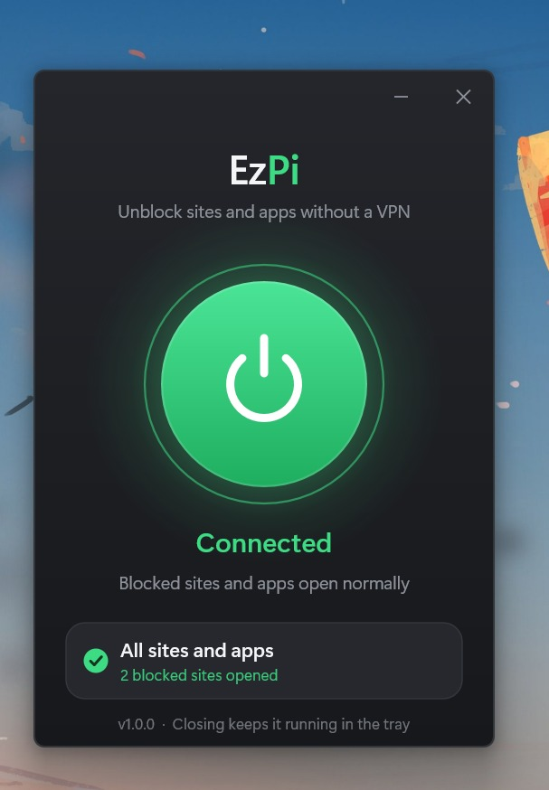

# EzPi

```
 _______   ________  ________  ___
|\  ___ \ |\_____  \|\   __  \|\  \
\ \   __/| \|___/  /\ \  \|\  \ \  \
 \ \  \_|/__   /  / /\ \   ____\ \  \
  \ \  \_|\ \ /  /_/__\ \  \___|\ \  \
   \ \_______\\________\ \__\    \ \__\
    \|_______|\|_______|\|__|     \|__|
```

**Open the sites and apps your internet provider blocks, with no VPN.**

EzPi is a small, local DPI bypass. There's no server, no account and no setup.

- **It hides the site's name.** Providers block by reading the name (SNI) in the TLS handshake. EzPi splits it up so the filter can't read it.
- **It never decrypts anything.** Your traffic stays end-to-end encrypted. EzPi installs no certificate.
- **It skips fake DNS answers.** It looks up the real address over DNS-over-HTTPS, so DNS poisoning doesn't work.

---

## Platforms

| Platform | Status | Get it |
|---|---|---|
| 🐧 **Linux** (x86-64) | ✅ Released | [`EzPi-linux-x64.tar.gz`](https://github.com/SunqdXX/ezpi/releases/latest/download/EzPi-linux-x64.tar.gz) (~3 MB) |
| 🪟 **Windows** 10/11 (x64) | ✅ Released | [`EzPi-windows-x64.exe`](https://github.com/SunqdXX/ezpi/releases/latest/download/EzPi-windows-x64.exe) (~600 KB) |
| 📱 **Android** 8.0+ | ✅ Released | [`EzPi-android.apk`](https://github.com/SunqdXX/ezpi/releases/latest/download/EzPi-android.apk) (~64 MB) |

| Android | Windows |
|:---:|:---:|
|  |  |

---

## Install

### 🐧 Linux
```sh
curl -LO https://github.com/SunqdXX/ezpi/releases/latest/download/EzPi-linux-x64.tar.gz
tar xzf EzPi-linux-x64.tar.gz && cd EzPi
sudo ./install.sh
ezpi --enable
ezpi --check
```
The installer adds one program (`/usr/local/bin/ezpi`), a systemd service and a config file (`/etc/ezpi/config.json`). If you have neither nftables nor iptables, it offers to install nftables for you. Nothing runs until you enable it.

### 🪟 Windows
1. Download **[EzPi-windows-x64.exe](https://github.com/SunqdXX/ezpi/releases/latest/download/EzPi-windows-x64.exe)** and open it.
2. The exe isn't signed yet, so Windows may show "Windows protected your PC". Click **More info → Run anyway**.
3. Click **Yes** on the one-time admin prompt. EzPi installs itself to `C:\Program Files\EzPi` and adds a desktop shortcut.
4. Press the big button. When it turns green, it's on.

More details: [`windows/README.md`](windows/README.md).

### 📱 Android
1. On your phone, download **[EzPi-android.apk](https://github.com/SunqdXX/ezpi/releases/latest/download/EzPi-android.apk)** and open it. If Android asks, allow installs from that app.
2. Open **EzPi**, tap the ring, and accept the VPN prompt once. No root is needed.

To build it yourself, see [`android/README.md`](android/README.md).

---

## Use (Linux)

| Command | What it does |
|---|---|
| `ezpi` | Turns it on if it's off, and off if it's on |
| `ezpi --enable` | Turns the bypass on |
| `ezpi --disable` | Turns it off and removes the firewall rule |
| `ezpi --status` | Shows whether it's on and what it's doing |
| `ezpi --check` | Live test against known-blocked hosts. Exits 1 if the bypass isn't working |
| `ezpi --tune` | Tries each split method on your connection and shows which ones work |
| `ezpi --wizard` | Shows the logo and a short explanation |
| `ezpi --restore` | Cleans up anything left over from a crash |

```
$ ezpi --status
EzPi: ON  (systemd)
  engine:   proxy
  strategy: record-sni
  covering: tcp/443, IPv4+IPv6
  quic:     udp/443 rejected (instant TCP fallback)
  dns:      DoH (defeats ISP DNS poisoning)
```

On a typical PC it uses about 28 MB of RAM while running.

---

## How it works

1. **Linux:** an nftables rule sends outgoing HTTPS (TCP 443) to EzPi on `127.0.0.1`. **Android:** a local `VpnService` does the same, all on the phone. **Windows:** a DNS policy rule points the handled names at EzPi.
2. EzPi looks up the real server address over DoH. It then sends the TLS ClientHello split in the middle of the site name (`record-sni` by default). If that's blocked, it falls back to other methods (`tcp-sni`, `record-multi`, `tcp-tiny`, `disorder`, and others) and remembers what works for each site.
3. QUIC (UDP 443) is refused right away, so apps switch to TCP, where the split applies.

The bypass logic lives in one shared Go engine ([`daemon/engine`](daemon/engine)) that Linux and Android both use. The Windows app is a separate Rust version of the same idea.

---

## Limits

- **It isn't a VPN or an anonymity tool.** Your provider still sees which IP addresses you connect to. It only stops them from reading the site name.
- **It only beats name-based blocking:** SNI filtering and DNS poisoning. It can't help when a provider blocks a server's IP address or slows traffic down.
- **Linux handles HTTPS only (TCP 443).** Plain HTTP isn't covered.
- **The Windows app only handles some names.** It handles Roblox and Discord, plus any name your provider sends to its block page (EzPi learns those at startup). Everything else goes straight through, untouched.
- **Android uses the phone's VPN slot,** so you can't run another VPN at the same time.
- **Where it's been tested,** by hand by the authors:
  - Linux and Android on Turkcell Superonline (home fiber)
  - Android on Turkcell mobile data
  - Windows on Türk Telekom

  There's no automated test against real ISPs. On another provider, run `ezpi --check` (or `ezpi --tune`) and see for yourself.

---

## Privacy and permissions

- **No accounts, analytics or telemetry.** EzPi sends nothing anywhere about you.
- **No certificate and no decryption.** EzPi only moves bytes it can't read.
- **DNS:** EzPi looks up sites over DNS-over-HTTPS at Cloudflare (`1.1.1.1`), Google (`8.8.8.8`) and Quad9 (`9.9.9.9`). Those services see the names you look up, the same as with any public DNS.

| Platform | Permission | Why |
|---|---|---|
| Linux | root (install, on/off) | To load the nftables redirect rule and run the systemd service. Members of `wheel` can turn it on and off with no password, everyone else gets a `sudo` prompt. |
| Windows | admin, once | To write the DNS policy (NRPT) rule. A scheduled task then starts it without asking again. |
| Android | VPN | To see the phone's traffic. It's a local VPN, so traffic doesn't go through any server. |
| Android | Notifications | Android needs a visible notification while the VPN runs. |

---

## Uninstall

- **Linux:** from the folder you installed from, run `sudo ./install.sh --uninstall`. Your settings stay in `/etc/ezpi`. Run `sudo rm -rf /etc/ezpi` to remove those too.
- **Windows:** right-click the EzPi tray icon and choose **Uninstall**. Everything gets put back.
- **Android:** uninstall the app like any other.

---

## Build from source

- **Linux and the shared engine** (Go): from the repo root, run `make build && make test`. That gives you `./ezpi`.
- **Android** (Go, gomobile, Gradle): see [android/README.md](android/README.md).
- **Windows** (Rust, MSVC): `cd windows && cargo build --release`. See [windows/README.md](windows/README.md).

## Contributing

Issues and pull requests are welcome.

- **To report a block,** say which provider you're on (Wi-Fi or mobile) and paste the output of `ezpi --check`. Don't post your IP address.
- **Before you open a PR,** run `make lint test`, or `cargo test` for the Windows app.

## Credits

- **Linux, Android and the shared engine:** [@SunqdXX](https://github.com/SunqdXX)
- **Windows:** [@yasinlol](https://github.com/yasinlol)

## License

[MIT](LICENSE) © 2026 sunqd
